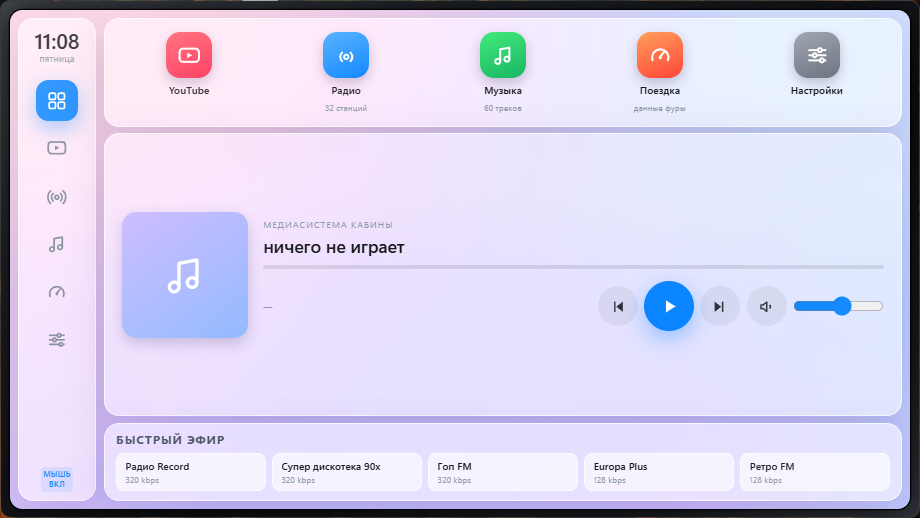
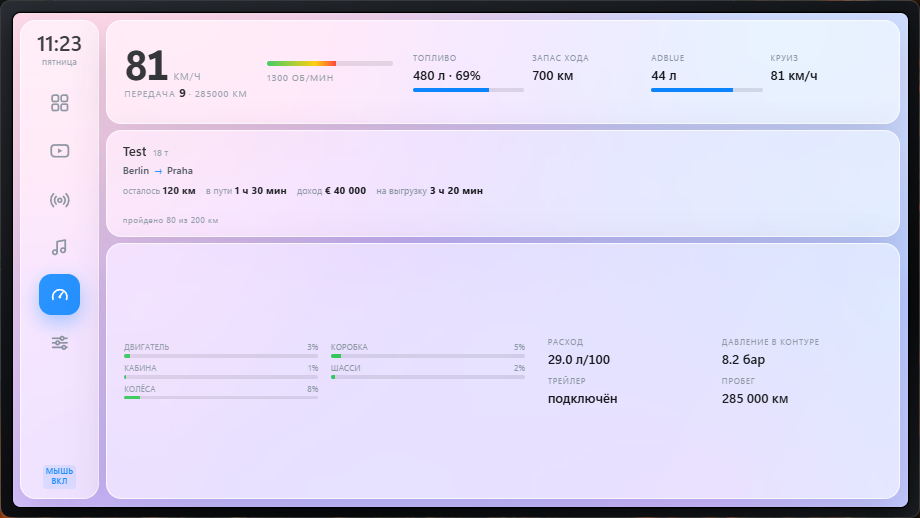
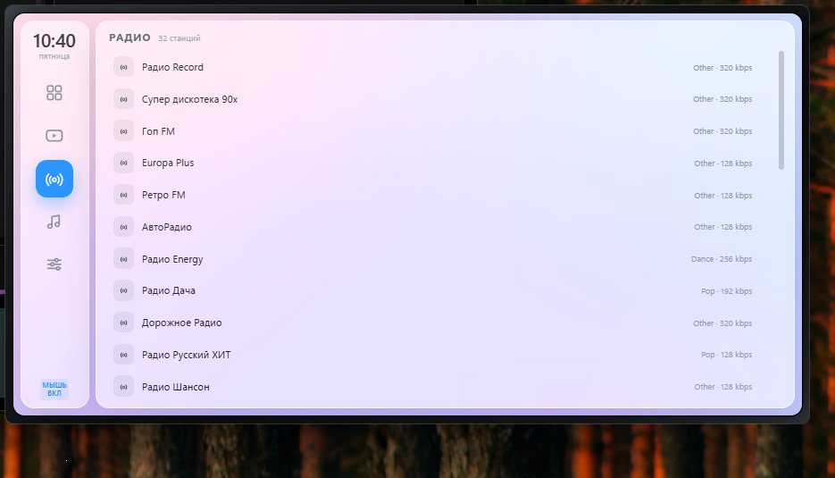
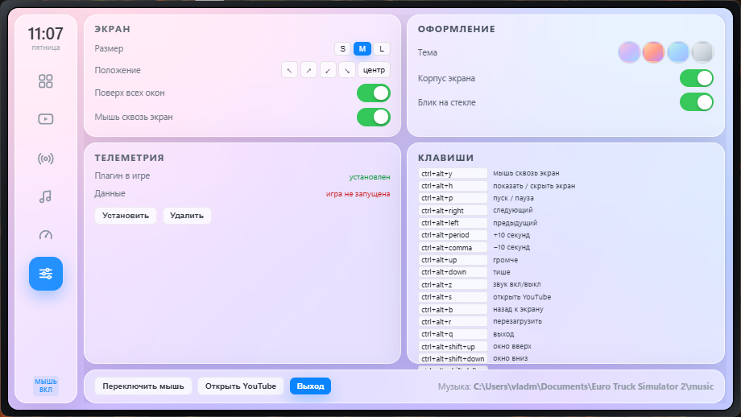

# TruckPlay

[](https://github.com/vladislav9939/truckplay/actions/workflows/build.yml)
[](https://github.com/vladislav9939/truckplay/releases)
[](LICENSE)

**Медиасистема кабины для Euro Truck Simulator 2 и American Truck Simulator.**
Свой экран поверх игры: YouTube, радио и музыка из твоей установки ETS2, телеметрия
фуры (скорость, топливо, груз, маршрут) и настройки — в одном окне без рамки,
которое не мешает рулить.

`Windows 10/11` · `Python 3.10+` · `WebView2` · `MIT`

<p align="center">
  
  
</p>
<p align="center">
  
  
</p>

---

## English TL;DR

TruckPlay is an in-cab media system for ETS2/ATS: a frameless always-on-top WebView2
window with YouTube, your ETS2 radio stations, your music folder, and live truck
telemetry from a bundled SCS-SDK plugin. Click-through by default, global hotkeys,
no external servers.

---

## Что внутри

| | |
|---|---|
| **YouTube** | встроенный плеер; кнопка «Открыть youtube.com» поднимает отдельное окно с настоящим сайтом, включённый ролик переезжает в экран кабины |
| **Радио** | станции из `live_streams.sii` — те же, что в штатном радио игры |
| **Музыка** | все треки из `Documents/Euro Truck Simulator 2/music`, с перемоткой |
| **Поездка** | скорость, передача, обороты, топливо, запас хода, AdBlue, круиз, одометр, износ узлов, груз, маршрут, доход, дедлайн, прогресс рейса |
| **Настройки** | размер и положение окна, 4 темы, тумблеры, статус телеметрии, список клавиш |

Экран живёт в двух режимах: **мышь сквозь экран** (рулишь, экран не мешает) и
**мышь по экрану** (кликаешь как по планшету). Переключение — `Ctrl+Alt+Y`.

## Установка

1. Скачайте `TruckPlay.exe` из [Releases](https://github.com/vladislav9939/truckplay/releases) и положите в любую папку.
2. `fix_borderless.bat` — один раз, переводит игру в borderless (иначе полный экран
   перекрывает окно). Делает резервную копию `config.cfg`.
3. `install_telemetry.bat` — один раз, ставит плагин телеметрии в папку плагинов игры.
4. Запустите `TruckPlay.exe`, затем игру.

`TruckPlay_autostart.bat` — ждёт запуска игры и поднимает экран сам.

## Горячие клавиши

| Комбинация | Действие |
|---|---|
| `Ctrl+Alt+Y` | мышь: сквозь экран / по экрану |
| `Ctrl+Alt+H` | показать / скрыть экран |
| `Ctrl+Alt+P` | пуск / пауза |
| `Ctrl+Alt+→` / `←` | следующий / предыдущий трек |
| `Ctrl+Alt+.` / `,` | +10 / −10 секунд |
| `Ctrl+Alt+↑` / `↓` | громче / тише |
| `Ctrl+Alt+Z` | звук вкл/выкл |
| `Ctrl+Alt+S` | открыть YouTube |
| `Ctrl+Alt+B` | вернуться к экрану |
| `Ctrl+Alt+R` | перезагрузить экран |
| `Ctrl+Alt+Shift+стрелки` | подвинуть окно |
| `Ctrl+Alt+Q` | выход |

Все комбинации меняются в `config.json`.

## Телеметрия

Игра не отдаёт данные наружу, поэтому в комплекте свой плагин на **SCS Telemetry SDK**:

1. плагин подписывается на каналы SDK (`truck.speed`, `truck.fuel.amount`,
   `job.cargo`, `truck.navigation.distance`, …);
2. на каждом кадре пишет JSON в `%LOCALAPPDATA%\TruckPlay\telemetry.json`
   (не чаще 10 раз в секунду, атомарная замена файла);
3. приложение читает файл и отдаёт странице через `GET /api/telemetry`.

Никаких сторонних программ и серверов. Плагин грузится при старте игры — после
установки игру нужно перезапустить.

## Сборка из исходников

```bat
python -m pip install pywebview pyinstaller
python -m PyInstaller --onefile --windowed --name TruckPlay ^
    --add-data "src\app.html;." ^
    --add-data "plugin\truckplay_telemetry.dll;plugin" ^
    --collect-all webview src\truckplay.py
```

Запуск без сборки:

```bat
git clone https://github.com/vladislav9939/truckplay
cd truckplay
python -m pip install -r requirements.txt
python src\truckplay.py
```

Плагин телеметрии (нужны MSVC x64 и заголовки SDK в `third_party\scssdk\include`):

```bat
plugin\build.bat
```

## Как это устроено

Подробнее — [docs/ARCHITECTURE.md](docs/ARCHITECTURE.md).

* окно без рамки и всегда поверх: `pywebview` (WebView2) + `WS_EX_TRANSPARENT`
  для сквозной мыши;
* интерфейс — локальная страница, отдаётся встроенным сервером `127.0.0.1:47615`;
* телеметрия — нативный плагин на C++ (SCS SDK) → JSON-файл;
* радио/музыка берутся из установки игры, поэтому список станций совпадает со штатным.

## Ограничения

Движок ETS2 не умеет проигрывать видео внутри 3D-кабины: экран — это окно поверх игры.
Планы: проецирование интерфейса в экран машины через хук D3D11 (как в закрытых
CarPlay-модах) — см. [docs/ARCHITECTURE.md](docs/ARCHITECTURE.md#roadmap).

## Лицензия

MIT. Сторонние компоненты — см. [LICENSE](LICENSE).
